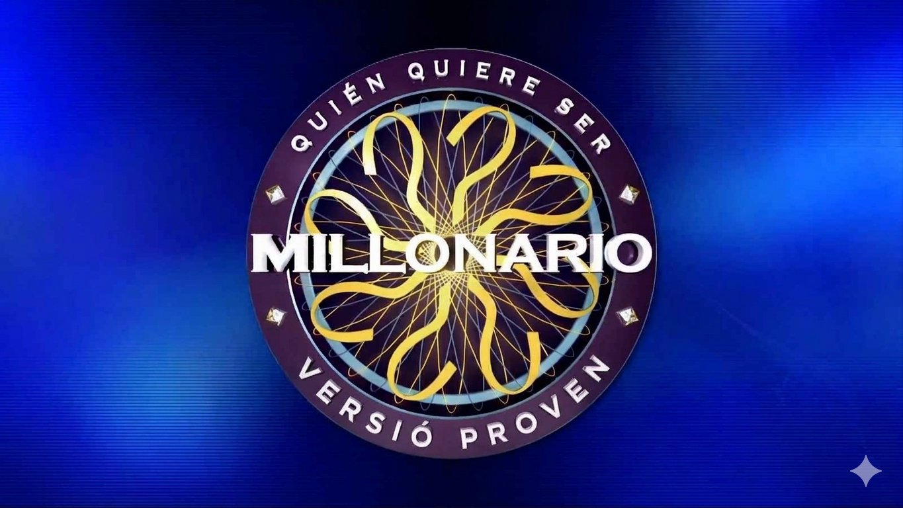

# Joc de Quizz Cultural

Crearem 2 mètodes per implementar entre tots un joc de preguntes culturals, potser qualsevol tema que domineu, sense que sigui ofensiu.

Heu de crear 2 mètodes inicialment.

· *Mètode 1* : Anomena'l **preguntaPrimera** Es un simple mètode que mostra la pregunta i les 4 opcions. A més ha d'esperar a que el jguador escrigui la resposta.
El mètode ha de retornar la resposta amb majúscula. 

· *Metode 2* : Anomena'l **respostaPrimera**, ha de rebre d'entrada un String que es la resposta. I ha de dir si has encertat.
També si has fallat , programa una resposta diferent per cada opció erronea valida, potser uan frase divertida, i fins i tot
si es una opció que no es cap de les esperades.

Fes la prova al main que funcionin.

Si encara no han acabat la resta de companys, fes dos mètodes més, per una segona pregunta i resposta.

Un cop ho tinguis puja'l aquí mateix (no cal carpeta) però puja sol el fitxer Java.

Un cop vegis en aquest directori fitxers del company, baixa'l al teu projecte, integra'l e intenta respondre correctament les preguntes culturals dels vostre companys.
